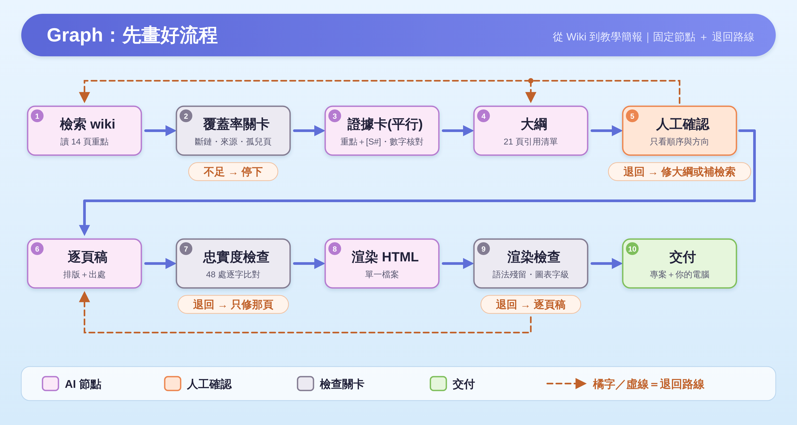

# 流程說明：從 LLM Wiki 到教學簡報

> 本文件說明這份作業**實際**怎麼做出來：流程是 loop 還是 graph、資訊怎麼取得、整理、檢查，再變成簡報。每一步都對應到資料夾裡真的存在的檔案與真的發生過的事。

## 1. 結論：用 Graph 先畫好流程，關卡上掛退回路線（Loop）

這次採用的是 **Graph（先畫好流程）**：10 個節點的順序事先固定，AI 不會自己決定下一步要做什麼。迴圈只出現在「退回路線」上：關卡沒通過，就沿橘色虛線回到指定的節點重做，做完再往下走。



（圖檔：`流程圖.png`／`流程圖.svg`；Mermaid 版：`tools/流程圖.mmd`）

- **為什麼用 Graph 而不是自由 Loop？** 作業的步驟可以事先寫死（Wiki → 證據 → 大綱 → 簡報），依 Wiki 的原則「先用最簡單的方案」[S1]，固定流程比讓模型每輪自己決定更可預測，也更容易逐關檢查。這對應 Wiki 中 [workflows-vs-agents](wiki/workflows-vs-agents.md) 所說的「Workflow 本質上是一張圖」。
- **退回路線就是 Loop**：這就是 Wiki 裡的「評估者－最佳化者」模式。重點是**退回的範圍要越小越好**：忠實度檢查不通過只修那一頁；渲染檢查不通過回到逐頁稿；只有人工確認認為方向錯了，才回到大綱或重新檢索。
- **簡報永遠不直接手改**：要改內容就回到 Wiki 或逐頁稿，再重新渲染，讓 Wiki 一直是唯一的知識來源。

## 2. 每個節點對應到的實際檔案與動作

圖例：紫＝AI 節點、橘＝人工確認、灰＝檢查關卡、綠＝交付、橘字＝退回路線。

| 節點 | 類型 | 實際做了什麼 | 對應檔案 | 退回條件 |
|---|---|---|---|---|
| 檢索 wiki | AI | 讀取 14 頁 Wiki，取出每頁的「## 重點」、摘要、表格、程式碼區塊 | `tools/wikilib.py` | — |
| 覆蓋率關卡 | 檢查 | 確認 10 個主題頁都在、每頁都有重點、每條重點都有來源、沒有斷鏈或孤兒頁（程式碼區塊與行內程式碼裡的 `[[範例]]` 不算連結） | `tools/check_wiki.py` | **不足 → 停下**（先回去補 Wiki，不生成簡報） |
| 證據卡（平行） | AI | 每條重點＋它的 `[S#]` 就是一張證據卡（共 46 張），各頁互不相依，可以平行處理；含數字的 8 張回到論文原文逐句核對 | `wiki/*.md`、`fact-check.md` | — |
| 大綱 | AI | 決定 21 頁的順序與每頁要引用哪幾張證據卡（例如第 7 頁＝agent-loop 重點 1、4、5） | `tools/build_slides.py` 中的頁面清單 | — |
| 人工確認 | 人工 | **只看教學順序與內容方向**（例如先講定義再講迴圈、有沒有漏掉重要概念）；版面與語法問題全部交給自動檢查 | `screenshots/` | **退回 → 修大綱，或補檢索** |
| 逐頁稿 | AI | 依大綱把證據卡排進每一頁，加上標題、圖表標籤、出處標示 | `tools/build_slides.py` | — |
| 忠實度檢查 | 檢查 | 簡報上 48 處引用（重點、程式碼、摘要、標題）必須和 Wiki 一字不差；每頁都要有 Wiki 出處 | `tools/check_slides.py` | **退回 → 只修那頁** |
| 渲染 HTML | AI | 組成單一 HTML 檔，含換頁、總覽、全螢幕、來源連結 | `AI-Agents-是什麼.html` | — |
| 渲染檢查 | 檢查 | 用真的 Chromium 開檔：換頁鍵／按鈕／網址跳頁、內容不溢出、主控台無錯誤、**畫面不得殘留 `[[ ]]` 語法、圖表尺寸與最小字級 ≥ 14px、截圖時動畫已結束**，並拍 21 張截圖 | `tools/check_slides.py` | **退回 → 逐頁稿** |
| 交付 | — | 存到專案資料夾與你電腦的第十週資料夾 | 整個 `ai-agents-wiki/` | — |

> 說明：Wiki 本身（取得來源、撰寫 13 頁）是在這張圖之前完成的「知識庫建置」階段，細節見下面第 3、4 節。這次的人工確認是由 Claude 看截圖完成的；之後若要交作業，建議由你再看一次截圖，作為正式的人工確認。

### 實際走過的退回路線
| 發生在 | 問題 | 走哪條退回路線 |
|---|---|---|
| 覆蓋率關卡 | 首頁說明文字裡的範例語法被當成斷鏈 | 不足 → 停下，修 Wiki 後重跑 |
| 渲染檢查 | 檢查器刻意封鎖網路字型，造成 2 個主控台錯誤（屬預期） | 修檢查器本身，排除這類錯誤 |
| 人工確認（看截圖） | 截圖時淡入動畫還沒播完、畫面偏淡 | 修檢查器，等動畫結束再截圖 |
| 人工確認（看截圖） | 「Agent 迴圈」圖太小 | 退回 → 逐頁稿，放大圖 |
| 人工確認（看截圖） | 決策樹裡露出原始連結語法 `[[agent-loop]]` | 退回 → 補檢索：改 Wiki，再從頭跑一次 |
| 忠實度檢查（故意破壞測試） | 把 Wiki 的「第一名」改成「第二名」但不重生簡報 | 檢查器抓到 `risks:1` 不一致；還原後通過 |

## 3. 資訊怎麼被「取得」

1. **先列概念再找來源**：先決定要講的 10 個概念（定義、元件、ReAct、規劃、工具、記憶、設計模式、多代理人、評估、風險），再替每個概念找「最早提出它的人」。
2. **用網路搜尋確認來源存在**：以 WebSearch 搜尋每篇論文或文章的標題，確認作者、年份、網址（例如 ReAct 的 arXiv 2210.03629、SWE-bench 的 arXiv 2310.06770）。
3. **來源選擇原則**（寫在 `sources.md`）：一手論文優先；經典定義（教科書）＋ 2022–2024 研究 ＋ 業界實務（Anthropic）＋ 安全標準（OWASP）四類都要有；數字只引原文。

## 4. 資訊怎麼被「整理」

每一頁 Wiki 都套用同一個格式，讓人和程式都讀得懂：

```
# 標題
> 摘要：一句話
## 重點          ← 只有這裡的句子可以上簡報，每條都要有 [S#]
- 句子。[S2]
## 說明          ← 表格、範例、程式碼區塊，補充用
## 相關頁面       ← 用 [[頁面]] 連到其他頁
```

- **一頁一概念、互相連結**：13 頁之間共有 112 個 wiki 連結，從首頁能連到每一頁。
- **自編內容要標示**：例如高鐵訂票例子、ReAct 範例對話，都寫明「教學自編，非引自來源」，不和有來源的事實混在一起。

## 5. 資訊怎麼被「檢查」

### 覆蓋率關卡：結構檢查（自動，`check_wiki.py`）
檢查 5 件事：無斷鏈（程式碼區塊與行內程式碼中的 `[[範例]]` 不算）、每頁都有必要段落、每條重點都有 `[S#]`、每個 `[S#]` 都在來源表且每個來源都有被用到、沒有孤兒頁。
**實際發生**：第一次執行就失敗了，因為首頁說明文字裡寫了範例語法 `[[頁面]]`，被當成指向不存在頁面的斷鏈。改寫成文字說明後重跑通過。

### 證據卡核對：事實檢查（`fact-check.md`）
所有含數字的重點（共 8 項），回到 arXiv 論文摘要頁逐句比對。例如「ReAct 在 ALFWorld／WebShop 高出 34%／10%」、「SWE-bench 2,294 題、Claude 2 解出 1.96%」、「ToT 在 24 點遊戲 74% vs CoT 4%」。8 項全部相符，所以沒有退回。

### 忠實度檢查＋渲染檢查（自動，`check_slides.py`，用真的 Chromium 瀏覽器開檔）
1. 每一頁都有標註 Wiki 出處（`data-wiki`）。
2. **逐字比對**：簡報上 48 個引用的重點句、程式碼、摘要、標題，必須和 Wiki 一字不差。
3. 換頁：→ 鍵、上一頁按鈕、網址 `#7` 跳頁都要正確。
4. 每頁內容不能超出畫面或壓到頁尾。
5. 瀏覽器主控台不能有錯誤（也測試了沒網路、字型載不到時仍正常）。
6. 畫面上的文字不能出現 `[[` 或 `]]`（Wiki 語法殘留）。
7. 每張圖表寬 ≥ 300px、高 ≥ 150px，圖中最小文字的實際字級 ≥ 14px。
8. 固定規則：每次換頁後等 450ms（大於 0.35 秒的淡入動畫）才檢查與截圖，並確認頁面不透明度為 1。

**實際發生**：
- 主控台出現 2 個錯誤，原因是檢查器刻意封鎖網路字型來模擬離線，屬於預期內，於是讓檢查器排除這類錯誤。
- **故意破壞測試**：把 Wiki 的「第一名」暫時改成「第二名」但不重新生成簡報，檢查器立刻報出 `risks:1 與 Wiki 不一致`；還原後通過。證明簡報真的被 Wiki 綁住。

### 人工確認：看截圖
**實際發生**：
- 截圖看起來偏淡 → 原因是截圖時換頁淡入動畫還沒播完，改成等動畫結束再截圖（屬檢查器修正）。
- 「Agent 迴圈」圖太小 → 退回逐頁稿放大圖（版面問題）。
- 「什麼時候該用 Agent」頁的決策樹裡出現原始語法 `[[agent-loop]]` → 這是 **Wiki 內容**的問題，所以走「補檢索」路線：改 Wiki 的程式碼區塊，再重跑覆蓋率關卡、逐頁稿、忠實度與渲染檢查。

## 6. 簡報內容怎麼被「生成」

`build_slides.py` 只做「挑選與排版」，不寫新知識：

- **能抽取的只有四種東西**：`## 重點` 的條列、`## 說明` 中的程式碼區塊、表格、`> 摘要`。
- **每頁有一份「引用清單」**：例如第 7 頁寫 `agent-loop:1, agent-loop:4, agent-loop:5`，程式就去那一頁抓第 1、4、5 條重點。
- **來源一路帶到簡報**：每句後面的 `[S#]` 變成可點的小標籤，點了會跳到最後一頁的參考來源；每頁底部顯示「📖 Wiki 出處：agent-loop.md › 重點 1、4、5」。
- **簡報上自己寫的只有**：頁面標題、圖表上的短標籤（如「Thought／Action／Observation」）、小測驗題目。小測驗的**答案**也是直接抽 Wiki 重點。
- **教學設計**：先講定義與光譜（為什麼需要 Agent）→ 元件 → 迴圈（核心）→ 三大能力 → 設計模式（何時不用）→ 多代理人 → 評估 → 風險 → 小測驗 → 總結三件事（取自三頁摘要）→ 參考來源。

## 7. 流程改進（2026-11-23）：把人工發現的問題變成自動檢查

回顧「實際走過的退回路線」：6 次退回裡有 **3 次發生在人工確認**，而且都是版面或語法問題，不是教學內容問題。這表示人工在做機器能做的事。所以做了以下改進：

| 當初人工發現的問題 | 新的自動檢查 | 放在哪 | 故意破壞測試結果 |
|---|---|---|---|
| 截圖時動畫還沒播完 | 等待時間定為固定常數 `ANIM_WAIT = 450`，並檢查截圖當下不透明度 = 1 | check_slides.py | 把等待改回 60ms → 抓到「第 1 頁動畫尚未結束（opacity=0.48）」 |
| 「Agent 迴圈」圖太小 | 圖表寬高下限＋圖中最小文字實際字級 ≥ 14px | check_slides.py | 把圖改回原尺寸 → 抓到「第 7 頁圖表文字太小：實際 13.0px」 |
| 決策樹露出 `[[agent-loop]]` | 頁面可見文字不得出現 `[[` 或 `]]` | check_slides.py | 把語法放回 Wiki → 抓到「第 15 頁殘留 Wiki 語法」 |

另外修正一個誤報來源：`check_wiki.py` 的斷鏈檢查現在會**排除程式碼區塊與行內程式碼**。當初首頁那次「斷鏈」其實是說明文字裡的範例語法 `[[頁面]]`，現在寫在行內程式碼裡就不會被誤判（測試：在首頁寫 `` `[[頁面]]` `` → Wiki 檢查通過）。

**分工也跟著調整**：
- 程式碼裡的 `[[ ]]` 不算 Wiki 連結，但如果它被顯示到簡報上，就由渲染檢查擋下。兩道關卡各管一件事。
- 人工確認只看「教學順序與內容方向」，因為這是程式判斷不了的；版面、語法、尺寸全部交給自動檢查。

改完後三支檢查全部重跑並通過（Wiki 14 頁、52 條重點、19 個來源；簡報 21 頁、48 處逐字比對）。

## 8. 如何重現

```bash
cd tools
python3 check_wiki.py      # 覆蓋率關卡
python3 build_slides.py    # 生成 AI-Agents-是什麼.html
python3 check_slides.py    # 忠實度檢查＋渲染檢查（需要 pip install playwright）
```

改 Wiki → 重跑這三行，簡報就會跟著更新。

## 9. 補充：這個流程本身就是一個 Agent 的例子

製作過程中，Claude 也是以 Wiki 裡講的「想 → 做 → 看」迴圈在工作：想好要查什麼 → 呼叫搜尋或執行檢查程式（工具）→ 看回傳結果 → 決定是修正還是往下走。而外層的固定流程圖，則是讓這個 Agent 不會亂跑的「Workflow 骨架」。
